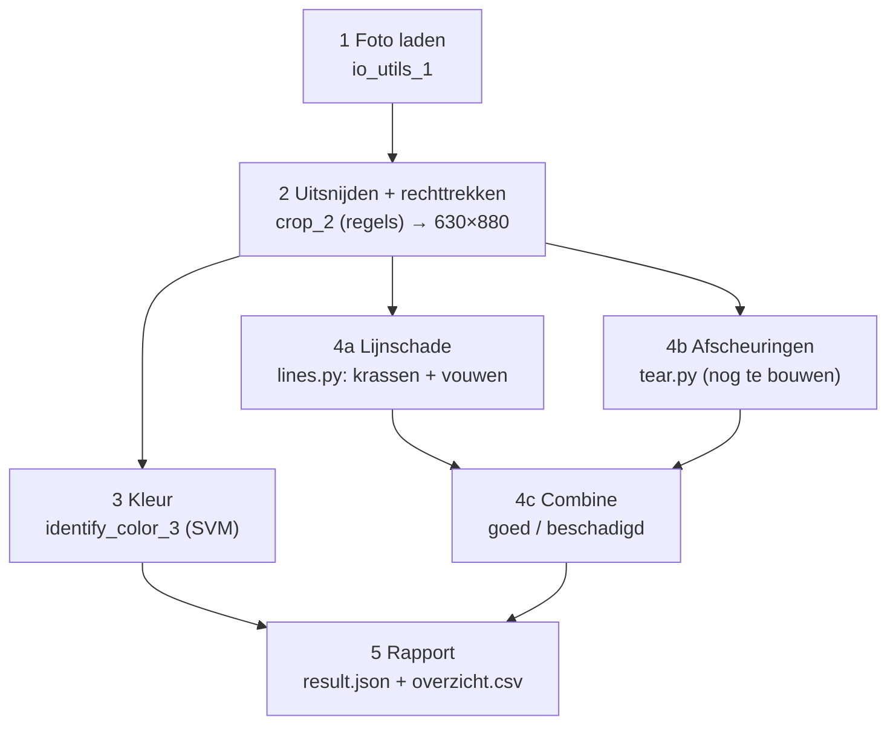

# TCG grading door AI (EASMVI70, groep 13)

Een vereenvoudigde, PSA-achtige kwaliteitscontrole voor ruilkaarten (Connor, Laurens, Thomas).
Per foto van één Magic: The Gathering-voorkant bepaalt de pipeline:

- de **kleur** van de kaart: `white`, `green`, `red`, `blue` of `black`;
- **Goed** of **Beschadigd**: krassen en vouwen (lijnschade). Scheuren volgen zodra het afscheuringenmodel klaar is.

Uitvoer per kaart: het oordeel, de scores per model en een kopie van de originele foto. Daarnaast komt er één overzicht van alle kaarten.

---

## Inhoud

1. [Snelstart](#1-snelstart)
2. [Hoe de pipeline werkt](#2-hoe-de-pipeline-werkt)
3. [Installeren](#3-installeren)
4. [De dataset](#4-de-dataset)
5. [De pipeline draaien](#5-de-pipeline-draaien)
6. [Resultaten bekijken](#6-resultaten-bekijken)
7. [Instellingen aanpassen](#7-instellingen-aanpassen)
8. [Modellen trainen en testen](#8-modellen-trainen-en-testen)
9. [Een stap los gebruiken (vanuit Python)](#9-een-stap-los-gebruiken-vanuit-python)
10. [Een eigen schademodel toevoegen](#10-een-eigen-schademodel-toevoegen)
11. [Projectstructuur](#11-projectstructuur)
12. [Problemen oplossen](#12-problemen-oplossen)

---

## 1. Snelstart

Vanuit de projectmap, in PowerShell:

```powershell
.venv\Scripts\activate
python main.py data\final_dataset\complete_dataset
```

Daarna:

- **Hoe goed deed hij het, per train/validate/test:** staat aan het eind van de terminal-uitvoer en in `output\results\evaluatie.txt`.
- **Alle kaarten in één tabel:** open `output\results\overzicht.csv` in Excel.
- **Eén kaart:** `output\results\<fotonaam>\result.json` plus de originele foto.
- **Tussenstappen bekijken:** zet `--debug` achter het commando en kijk in `output\debug\<fotonaam>\`.

---

## 2. Hoe de pipeline werkt

Het is een multistage-pipeline: elk onderdeel is een eigen bestand met een eigen model (of, bij het uitsnijden, eigen regels). Elk onderdeel is los te bouwen, te trainen en te testen.



| Stap | Wat | Bestand | Status |
| --- | --- | --- | --- |
| 1 | Foto laden | `pipeline/io_utils_1.py` | klaar |
| 2 | Kaart vinden, uitsnijden, rechttrekken naar 630×880 (regels, geen model) | `pipeline/crop_2.py` | klaar |
| 3 | Kleur: rood, groen, blauw, zwart of wit | `pipeline/identify_color_3.py` | klaar (test 97%) |
| 4a | Lijnschade: krassen + vouwrandjes | `pipeline/damage_4/lines.py` | klaar (test 84%, SVM op 19 standaardfeatures) |
| 4b | Afscheuringen | `pipeline/damage_4/tear.py` | **te bouwen** (wordt overgeslagen) |
| 4c | Scores samenvoegen tot Goed/Beschadigd | `pipeline/damage_4/combine.py` | klaar |
| 5 | Rapport per kaart + overzicht | `pipeline/report_5.py` | klaar |

**Hoe het oordeel tot stand komt (combine):** een kaart is **beschadigd** zodra één schademodel een score heeft die gelijk is aan of hoger dan zijn eigen drempel (`DAMAGE_THRESHOLDS` in `pipeline/config.py`; voor `lines` is dat 0,5).
Een model dat nog niet gebouwd is, wordt overgeslagen. In het resultaat staat altijd op welke modellen het oordeel is gebaseerd (`damage_checked` / "gecontroleerd op"). Zolang `tear` niet bestaat, betekent "goed" dus: **goed voor krassen en vouwen**.

Uitleg per stap (wat, waarom, hoe): [`docs/pipeline.md`](docs/pipeline.md).

---

## 3. Installeren

Python 3.12 of nieuwer:

```powershell
python -m venv .venv
.venv\Scripts\activate
pip install -r requirements.txt
```

Alle versies staan vast in `requirements.txt` (NumPy, OpenCV, scikit-learn, joblib), zodat iedereen hetzelfde resultaat krijgt.

> **Windows Smart App Control** blokkeert een DLL van scipy, en daardoor werkt scikit-learn niet. Zet Smart App Control uit. Let op: het kan daarna niet meer aan zonder Windows opnieuw te installeren.

**Activeer de venv altijd eerst** (`.venv\Scripts\activate`; je ziet dan `(.venv)` voor je prompt) en **draai alle commando's vanuit de projectmap**.

---

## 4. De dataset

De foto's staan niet in git (~400 MB). Ze worden via OneDrive/Teams gedeeld. Zet ze in `data/`:

```
data/final_dataset/
├── complete_dataset/        alle 180 foto's in één platte map  ← hierop draai je main.py
├── train_dataset/           90 foto's, per kleur een submap (black/ blue/ green/ red/ white/)
├── validate_dataset/        60 foto's, zelfde indeling
└── test_dataset/            30 foto's, zelfde indeling
```

**Bestandsnaam = label:** `<kleur>_<schade>_<nr>.jpeg`, bijvoorbeeld `rood_kras_04.jpeg`.

| Deel | Waarden |
| --- | --- |
| kleur | `blauw`, `groen`, `rood`, `wit`, `zwart` |
| schade | `geen`, `kras`, `vouw`, `scheur` (en eventueel `mix`, wordt niet gebruikt) |

De training leest de labels uit de bestandsnaam (`training/dataset.py`). Het kleurmodel leest de kleur uit de submap (`black/` …).
Een andere dataset gebruiken: pas `DATASET_DIR` aan in `pipeline/config.py`, of geef bij trainen `--data <map>` mee.

---

## 5. De pipeline draaien

```powershell
python main.py <map met foto's> [--debug]
```

| Voorbeeld | Wat |
| --- | --- |
| `python main.py data\final_dataset\complete_dataset` | alle 180 foto's |
| `python main.py data\final_dataset\test_dataset\red` | alleen de rode testkaarten (6 foto's, snel) |
| `python main.py data\mijn_fotos --debug` | eigen foto's, met alle tussenplaatjes |

- `main.py` zoekt **niet** in submappen. Geef een map die direct `.jpg`, `.jpeg` of `.png` bevat.
- De foto's worden op naam gesorteerd en één voor één verwerkt (~1 seconde per foto).
- Lukt het uitsnijden van een foto niet (geen kaartvorm gevonden), dan komt de reden in `error` en gaat de run door met de volgende foto.

### Wat je in de terminal ziet

```
rood_geen_16.jpeg        kleur red    schade goed       (lines 0.13, tear -)
rood_kras_06.jpeg        kleur red    schade beschadigd (lines 0.92, tear -)
...
180 kaarten: 129 goed, 51 beschadigd, 0 met fout
  black   35 kaarten, 13 beschadigd
  ...
EVALUATIE: ... (scores per split, zie 6.0)
Overzicht van alle kaarten: ...\output\results\overzicht.csv
Evaluatie per split:        ...\output\results\evaluatie.txt
Per kaart (result.json + foto): ...\output\results

Nog niet gebouwd (eerste ontbrekende functie per model):
  damage_4.tear.preprocess
```

- `lines 0.92`: de score van het lijnschademodel (0 = zeker geen kras/vouw, 1 = zeker wel).
- `tear -`: het afscheuringenmodel is nog niet gebouwd en is overgeslagen.
- De melding "Nog niet gebouwd" is normaal zolang `tear.py` niet af is.

---

## 6. Resultaten bekijken

Alles komt in `output/` (staat niet in git). Een nieuwe run overschrijft de resultaten van dezelfde foto's.

### 6.0 Scores per split: `output/results/evaluatie.txt`

Hebben alle foto's een naam als `rood_kras_04.jpeg` (onze dataset), dan vergelijkt `main.py` aan het eind elk oordeel met het label in de bestandsnaam.
Per foto zoekt hij op in welke split hij zit: hij kijkt in welke map van `data/final_dataset/` (`train_dataset`, `validate_dataset` of `test_dataset`) de naam voorkomt.
Dezelfde tekst staat in de terminal en in `output/results/evaluatie.txt`. Bij eigen foto's zonder labels in de naam wordt dit overgeslagen.

```
KLEUR
  split        n  accuracy  fout
  train       90      100%     0
  validate    60       98%     1
  test        30       97%     1
  totaal     180       99%     2

SCHADE, eindoordeel goed/beschadigd (scheur-kaarten niet meegeteld: scheurmodel nog niet gebouwd)
  split        n  accuracy  precision  recall  F1  gave afgekeurd  kras gevonden  vouw gevonden
  train       75       89%        96%     77%   85%            1/45          10/15          13/15
  ...
FOUTE KAARTEN (score = lines-score)
  test:
    verkeerde kleur (1): blauw_geen_18.jpeg (green)
    gave kaart afgekeurd (1): groen_geen_17.jpeg (0.84)
    schade gemist (7): ...
```

| Blok | Wat het zegt |
| --- | --- |
| KLEUR | deel van de kaarten waarvan de kleur klopt |
| SCHADE | het eindoordeel tegen het label: `geen` = goed, `kras`/`vouw` = beschadigd. `scheur`-kaarten doen niet mee, omdat scheuren nog niet gezocht worden (`tear.py`) |
| FOUTE KAARTEN | namen van de fout beoordeelde kaarten, met hun score. Draai `main.py --debug` en open `4a_highpass.png` om te zien waarom |

- **accuracy:** deel van de oordelen dat klopt.
- **precision:** van de kaarten die "beschadigd" genoemd worden, het deel dat echt beschadigd is.
- **recall:** van alle beschadigde kaarten, het deel dat gevonden is.
- **gave afgekeurd:** gave kaarten die toch "beschadigd" genoemd worden. Voor ons de ergste fout.
- **Let op bij train:** de modellen zijn op die foto's getraind, dus die cijfers zijn te optimistisch. Kijk vooral naar validate en test.

### 6.1 Alle kaarten in één tabel: `output/results/overzicht.csv`

Eén regel per kaart van de **laatste run**. Het bestand gebruikt `;` en een decimale komma, zodat het in Nederlandse Excel direct in kolommen opent (dubbelklikken is genoeg).

| Kolom | Betekenis |
| --- | --- |
| `foto` | bestandsnaam |
| `kleur` | voorspelde kleur |
| `schade` | `goed` of `beschadigd` (leeg bij een fout) |
| `gecontroleerd op` | modellen waarop het oordeel gebaseerd is, nu `lines` |
| `score lines`, `score tear` | score 0–1 per schademodel (leeg = model niet gebouwd) |
| `fout` | bijv. `kaart niet gevonden: ...` |
| `nog niet gebouwd` | eerste ontbrekende functie per model |

Handig in Excel: **Gegevens → Filter**, dan kun je bijvoorbeeld alleen `beschadigd` tonen of sorteren op `score lines`.

Zonder Excel, in PowerShell:

```powershell
# alle beschadigde kaarten
Import-Csv output\results\overzicht.csv -Delimiter ';' | Where-Object schade -eq 'beschadigd' | Format-Table foto, kleur, 'score lines'

# aantallen per kleur en oordeel
Import-Csv output\results\overzicht.csv -Delimiter ';' | Group-Object kleur, schade | Format-Table Count, Name
```

### 6.2 Eén kaart: `output/results/<fotonaam>/`

- `result.json`: alle gegevens van die kaart
- een kopie van de originele foto

```json
{
  "photo": "rood_vouw_06.jpeg",
  "color": "red",
  "damage": "beschadigd",
  "damage_scores": { "lines": 0.5738, "tear": null },
  "damage_checked": ["lines"],
  "error": null,
  "not_built": ["damage_4.tear.preprocess"]
}
```

`null` betekent: niet bekend (model niet gebouwd, of de foto gaf een fout).

### 6.3 Tussenstappen: `output/debug/<fotonaam>/` (alleen met `--debug`)

| Bestand | Wat je ziet |
| --- | --- |
| `2a_blur.png` | grijze, vervaagde kopie op ¼ grootte |
| `2b_canny.png` | gevonden randen |
| `2c_closed.png` | randen met de gaatjes dichtgemaakt |
| `2d_mask.png` | masker: kaart wit, achtergrond zwart |
| `2e_corners.png` | masker met de gevonden rechthoek en hoeknummers 0–3 |
| `2_crop.png` | rechtgetrokken kaart, 630×880: **wat alle modellen te zien krijgen** |
| `4a_gray.png` | lijnschade: grijze kaart |
| `4a_highpass.png` | lijnschade: hoeveel lichter elke pixel is dan zijn omgeving (×4 versterkt). Krassen en vouwen zijn hier lichte lijnen |
| `4a_bright.png` | lijnschade: de pixels boven `LINES_BRIGHT`, de invoer van Hough |
| `4a_lines.png` | lijnschade: de gevonden Hough-lijnen (geel = telt mee, blauw = langs het kader) |
| `4_color.png`, `4_color.json` | kleur: het stuk van de kaart waar het model naar kijkt en de kans per kleur |

Tip: denkt het model dat een gave kaart beschadigd is, open dan `4a_highpass.png` van die kaart. Je ziet dan meestal welke lichte lijn de score omhoog trekt.
Zonder `--debug` wordt er niets opgeslagen.

### 6.4 Hoe goed doen de modellen het?

`main.py` geeft het oordeel, maar vergelijkt dat niet met de echte labels. Voor cijfers (accuracy, precision, recall, confusion matrix):

```powershell
python -m training.evaluate lines        # lijnschademodel op de test-set
python -m training.train_color --test    # kleurmodel op de test-set
```

Uitleg van de uitvoer: zie [8. Modellen trainen en testen](#8-modellen-trainen-en-testen).

---

## 7. Instellingen aanpassen

Alle parameters staan op één plek: **`pipeline/config.py`**. Elke parameter heeft een naam en een comment waarom die waarde gekozen is.

| Parameter | Nu | Waarvoor | Opnieuw trainen nodig? |
| --- | --- | --- | --- |
| `DAMAGE_THRESHOLDS["lines"]` | 0,5 | vanaf welke score een kaart beschadigd is. Lager = meer schade gevonden, maar ook meer gave kaarten afgekeurd | nee |
| `DATASET_DIR` | `data/final_dataset` | welke dataset de training gebruikt | – |
| `LINES_BRIGHT` | 35 | vanaf welke high-pass-waarde een pixel als lijnpixel telt | **ja** |
| `LINES_HIST_EDGES`, `LINES_HOUGH_*`, `LINES_MIN_LENGTH_PX`, `LINES_MIN_ANGLE_DEG`, `LINES_LENGTH_CLASSES_MM` | zie bestand | histogram en lijnen zoeken | **ja** |
| `CROP_*` | zie bestand | kaart vinden en uitsnijden | ja (alle modellen zien dan een andere uitsnede) |

**Vuistregel:** verander je iets aan de voorbewerking of de features, train het model dan opnieuw (`python -m training.train lines`). Een drempel in `DAMAGE_THRESHOLDS` werkt direct, zonder opnieuw te trainen.

We kiezen 0,5 als drempel, omdat **een gave kaart afkeuren de ergste fout** is.

---

## 8. Modellen trainen en testen

De getrainde modellen staan in `models/`:

| Bestand | Model |
| --- | --- |
| `lines.joblib` | lijnschade (StandardScaler + SVC) |
| `color_model.joblib` | kleur |

### Lijnschademodel

```powershell
python -m training.train lines       # trainen op train_dataset, uitslag op train + validate
python -m training.evaluate lines    # uitslag op test_dataset
```

`train` overschrijft `models/lines.joblib`.
Met `--data <map>` gebruik je een andere dataset.

De uitvoer heeft dezelfde vorm als bij het kleurmodel: per split (train, validate, test) accuracy, een classification report en een confusion matrix. Scheur-kaarten tellen niet mee (het scheurmodel bestaat nog niet). Met `--per-photo` zie je ook de score per foto. Voorbeeld (test):

```
Accuracy: 0.8400 (84.00%)

              precision    recall  f1-score   support
        goed       0.82      0.93      0.88        15
  beschadigd       0.88      0.70      0.78        10

Rows = actual, columns = predicted  (order: goed, beschadigd)
[[14  1]
 [ 3  7]]
```

- Rechtsboven in de matrix staat de ergste fout: een gave kaart die als beschadigd is afgekeurd. Linksonder staat beschadigd gemist.
- `scheur`-kaarten hebben voor het lijnmodel label 0 bij het trainen, maar tellen niet mee in het rapport.

### Kleurmodel

```powershell
python -m training.train_color          # trainen op train_dataset, uitslag op validate, opslaan
python -m training.train_color --test   # bestaand model testen op test_dataset
```

### Afspraken over de datasplitsing

- **train**: om te trainen.
- **validate**: om versies te vergelijken en instellingen te kiezen.
- **test**: alleen aan het eind, om de gekozen versie te bevestigen. Kies geen instellingen op basis van test, anders zegt die uitslag niets meer over nieuwe kaarten.
- Validate is klein (20 beschadigde kaarten).

---


## 9. Een stap los gebruiken (vanuit Python)

Elke stap is een gewone functie. Bijvoorbeeld één foto uitsnijden en de lijnschade-score berekenen:

```python
from pathlib import Path
import cv2
from pipeline import crop_2, io_utils_1
from pipeline.damage_4 import lines

image = io_utils_1.load_image(Path("data/final_dataset/complete_dataset/wit_kras_02.jpeg"))
card = crop_2.crop_card(image)                 # array (880, 630, 3): hoogte, breedte, BGR
cv2.imwrite("output/kaart.png", card)

highpass = lines.preprocess(card)
score = lines.predict(lines.load_model(), lines.features(highpass))
print(f"lijnschade-score: {score:.2f}")
```

Wil je ook de tussenplaatjes, geef dan een `show`-functie mee:

```python
show = lambda img, step: io_utils_1.save_debug_image(img, "wit_kras_02", step)
card = crop_2.crop_card(image, show)
```

Lukt het uitsnijden niet (geen kaartvorm gevonden), dan volgt `crop_2.CardNotFoundError` met de reden.

---

## 10. Een eigen schademodel toevoegen

Elk schademodel is één bestand in `pipeline/damage_4/` met dezelfde 6 functies, zodat `main.py` en `training/` ze allemaal op dezelfde manier aanroepen:

| Functie | Doet |
| --- | --- |
| `preprocess(card, show)` | kaart → plaatje waarin deze schade opvalt; tussenplaatjes via `show(img, "4b_…")` |
| `features(image)` | plaatje → getallen voor de classifier |
| `train(features, labels)` | getraind model (label 1 = deze schade, 0 = niet) |
| `save_model(model)` / `load_model()` | model opslaan in / laden uit `models/` |
| `predict(model, features)` | schadescore 0–1 |

- **Bouwvolgorde:** begin met `preprocess` en `features` en bekijk de plaatjes met `--debug`. Daarvoor is nog geen getraind model nodig. Een functie die `NotImplementedError` geeft, wordt overgeslagen en verschijnt onder "Nog niet gebouwd".
- **Nieuw model** (bijv. snedes): kopieer `lines.py` naar `cut.py`, bouw de 6 functies en zet één regel in `MODELS` in `pipeline/damage_4/__init__.py`.
- **Labels:** voeg een regel toe aan `LABELS` in `training/dataset.py` (welk schadewoord in de bestandsnaam 1 of 0 is).
- **Drempel:** voeg je model toe aan `DAMAGE_THRESHOLDS` in `pipeline/config.py`. Daarna telt het automatisch mee in het oordeel en in "gecontroleerd op".
- **Parameters** van je model komen in `pipeline/config.py`, onder een eigen kopje.
- **Samenwerken:** werk in je eigen modelbestand; dan zit je niet in de code van een ander.

---

## 11. Projectstructuur

```
machine_vision/
├── main.py                     pipeline draaien op een map met foto's
├── pipeline/
│   ├── config.py               alle paden en parameters (met reden)
│   ├── io_utils_1.py           1 foto's laden, debugplaatjes opslaan
│   ├── crop_2.py               2 kaart vinden en rechttrekken
│   ├── identify_color_3.py     3 kleurmodel
│   ├── damage_4/
│   │   ├── __init__.py         lijst MODELS
│   │   ├── lines.py            4a lijnschade (krassen + vouwen)
│   │   ├── tear.py             4b afscheuringen (te bouwen)
│   │   └── combine.py          4c scores → goed / beschadigd
│   └── report_5.py             5 result.json + overzicht.csv
├── training/
│   ├── dataset.py              labels uit bestandsnamen, train/val/test
│   ├── train.py                schademodel trainen
│   ├── evaluate.py             schademodel testen
│   ├── score_run.py            uitslag van main.py per split vergelijken met de labels
│   └── train_color.py          kleurmodel trainen/testen
├── models/                     getrainde modellen (.joblib)
├── data/                       dataset (niet in git)
├── output/                     resultaten en debugplaatjes (niet in git)
├── docs/
│   └── pipeline.md             uitleg per stap
└── requirements.txt
```

---

## 12. Problemen oplossen

| Melding | Oorzaak / oplossing |
| --- | --- |
| `Geen foto's in map: ...` | de map heeft submappen (bijv. `test_dataset`). Geef een map die direct foto's bevat, zoals `test_dataset\red` of `complete_dataset` |
| `ModuleNotFoundError: No module named 'pipeline'` | niet vanuit de projectmap gestart. Bij scripts in `output\...` eerst `$env:PYTHONPATH = "."` |
| `ModuleNotFoundError: No module named 'cv2'` / `sklearn` | venv niet actief: `.venv\Scripts\activate` |
| `models\lines.joblib not found` | model nog niet getraind: `python -m training.train lines` |
| fout bij het laden van het kleurmodel | het kleurmodel zoekt `models/` vanuit de map waarin je staat: start vanuit de projectmap |
| DLL-fout bij `import sklearn` | Windows Smart App Control staat aan (zie [Installeren](#3-installeren)) |
| `kaart niet gevonden` in de kolom `fout` | geen kaartvorm in de foto (andere achtergrond, kaart half in beeld). Bekijk `2b_canny.png` en `2d_mask.png` met `--debug` |
