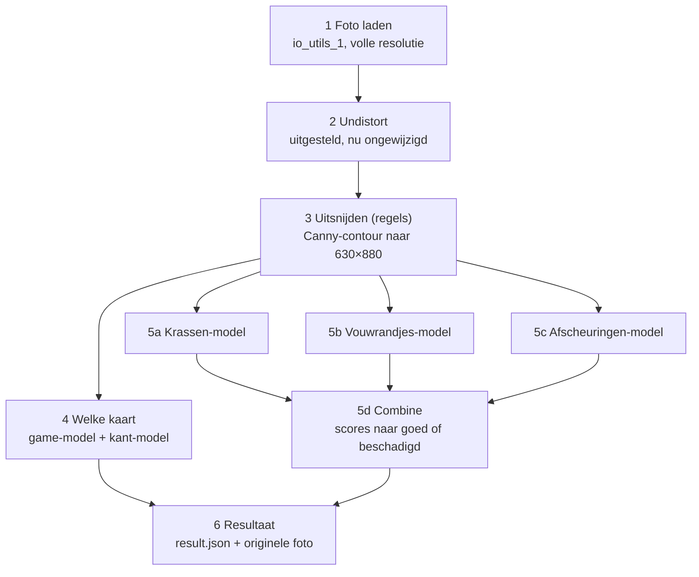

# Pipeline TCG-grading — hoe het werkt

Stand van 2 november 2026.

## Overzicht

De pipeline krijgt een map met kaartfoto's en geeft per kaart drie oordelen: Pokémon of MTG, voor- of achterkant, en Goed of Beschadigd. Sinds 2 november is het een **multistage**-pipeline: elk onderdeel heeft een eigen model, dat los te bouwen, trainen en testen is. Alleen het uitsnijden werkt met regels die wij zelf kiezen, want dat haalt 40/40 zonder labels. Stap 1 t/m 3 en 6 werken; stap 4 en 5 bestaan als skelet (functienamen en docstrings, nog `NotImplementedError`).



Alle modellen krijgen dezelfde uitgesneden kleurenkaart. Elk schademodel doet zijn **eigen voorbewerking** (bijv. high-pass voor krassen) en levert een score van 0–1. `combine` maakt van die scores Goed of Beschadigd.

| Stap | Wat | Bestand | Status |
| --- | --- | --- | --- |
| 1 | Foto laden | `pipeline/io_utils_1.py` | Klaar |
| 2 | Lensvervorming corrigeren (undistort) | `pipeline/undistort_2.py` | Uitgesteld |
| 3 | Kaart vinden, uitsnijden en rechttrekken (regels) | `pipeline/crop_3.py` | Klaar |
| 4 | Game (MTG/Pokémon) en kant (voor/achter) | `pipeline/identify_4.py` | Te bouwen |
| 5a | Krassen | `pipeline/damage_5/scratch.py` | Te bouwen |
| 5b | Vouwrandjes | `pipeline/damage_5/crease.py` | Te bouwen |
| 5c | Afscheuringen | `pipeline/damage_5/tear.py` | Te bouwen |
| 5d | Scores samenvoegen | `pipeline/damage_5/combine.py` | Te bouwen |
| 6 | Resultaat + originele foto opslaan | `pipeline/report_6.py` | Klaar |

Alle parameters staan op één plek: `pipeline/config.py`, elk met een naam en een reden. Trainingscode staat los in `training/` (per model: `python -m training.train <model>`); getrainde modellen komen in `models/`.

## Hoe draaien

Je start de pipeline met één commando op een map met foto's:

```
python main.py data/schade_class_v2/complete_dataset --debug
```

- **Invoer:** een map met `.jpg`, `.jpeg` of `.png`. De foto's worden op naam gesorteerd en één voor één verwerkt.
- **Eindresultaat:** per kaart een map `output/results/<fotonaam>/` met `result.json` (game, kant, schade, score per schademodel, fout, nog niet gebouwd) en een kopie van de originele foto.
- **Tussenresultaten (`--debug`):** per kaart een map `output/debug/<fotonaam>/` met een PNG per (sub)stap. Zonder `--debug` wordt er niets opgeslagen, dus geen schijfruimte gebruikt.
- **Nog niet gebouwde modellen** worden overgeslagen (waarde `null` in `result.json`); de andere modellen draaien door. Aan het eind meldt het programma per model de eerste functie die nog gebouwd moet worden, bijv. `damage_5.tear.preprocess`. Zo kan iedereen los aan een eigen model werken.

| Debugplaatje | Wat je ziet |
| --- | --- |
| `2_undistort.png` | De foto na stap 2 (nu nog gelijk aan het origineel) |
| `3a_blur.png` | Grijze, vervaagde kopie op ¼ grootte |
| `3b_canny.png` | De gevonden randen |
| `3c_closed.png` | Randen met de gaatjes dichtgemaakt |
| `3d_mask.png` | Het masker: kaart wit, achtergrond zwart |
| `3e_corners.png` | Masker met rechthoek en hoeknummers 0–3 |
| `3_crop.png` | De rechtgetrokken kaart, 630×880 |
| `5a_…` / `5b_…` / `5c_…` | Tussenplaatjes van het krassen-, vouwrandjes- en afscheuringenmodel |

Installeren: Python 3.12, een `venv`, en `pip install -r requirements.txt` (OpenCV en NumPy, vastgepinde versies).

## Stap 1 — Foto laden

Stap 1 zoekt de foto's in de opgegeven map en laadt ze op volle resolutie (4032×3024) als BGR-array. Bestand: `pipeline/io_utils_1.py`.

- **`list_images(folder)`** geeft de foto's gesorteerd op naam terug. Extensies tellen ongeacht hoofdletters (`.JPEG` telt mee). Een map die niet bestaat of leeg is geeft een duidelijke foutmelding.
- **`load_image(path)`** leest de foto met `cv2.imread`. Waarom een eigen check: `imread` geeft bij een kapot bestand geen fout maar `None`, en dan zou de pipeline pas veel later vastlopen met een onduidelijke fout.
- **`save_debug_image(image, card, step)`** slaat een tussenresultaat op als PNG in `output/debug/<kaart>/`. Waarom PNG: JPEG-compressie geeft blokjes die later op krasjes kunnen lijken.
- **Valkuil:** OpenCV laadt kleuren als BGR, niet RGB.

## Stap 2 — Lensvervorming corrigeren (uitgesteld)

Stap 2 geeft de foto voorlopig onveranderd terug. Bestand: `pipeline/undistort_2.py`.

- **Waarom uitgesteld:** kalibratie geldt per camera, en welke camera we gebruiken staat nog niet vast (waarschijnlijk een iPhone, die lensvervorming al grotendeels in software corrigeert).
- **Later, met een vaste camera:** kalibreren met een schaakbordpatroon (`cv2.calibrateCamera` + `cv2.undistort`), en daarna met een foto van een recht raster controleren of rechte lijnen recht blijven.
- **Ook voor deze stap: scheefstand.** Een camera die vast boven de band hangt, hangt bij elke kaart even scheef. Op onze handgemaakte foto's is bij 10 van de 40 de ene korte zijde 2–3 mm breder dan de andere. Die scheefstand werken we hier één keer voor de hele foto weg, zodat stap 3 hem niet hoeft op te lossen.

## Stap 3 — Kaart uitsnijden en rechttrekken

Stap 3 vindt de kaart op de witte achtergrond en levert een rechte, staande kaart van 630×880 px (63×88 mm bij 10 px/mm). Alle 40 foto's van `schade_class_v2` slagen, ook de gescheurde kaarten; het kost 33 ms per foto. Bestand: `pipeline/crop_3.py`.

**Twee ideeën achter deze stap:**

- **Zoeken klein, rechttrekken groot.** De kaart wordt gezocht op een kopie van ¼ grootte (1008×756): snel, en precies genoeg voor de omtrek. Het rechttrekken gebeurt vanuit de volle foto, zodat er zo veel mogelijk detail overblijft voor de schadestap.
- **Canny-contour in plaats van kleur.** Gekozen na een test van 3 methodes op 40 foto's: Canny haalde 40/40, donkere rand + Otsu 35/40, de oude helderheidsmethode 0/40. Canny leunt niet op de zwarte rand van MTG-kaarten, dus werkt later ook bij de gele rand van Pokémon.

**De substappen:**

1. **Verkleinen (`crop_card`).** `cv2.resize` naar ¼ met `INTER_AREA`, dat pixels middelt zodat er geen trapjes of ruis ontstaan.
2. **Grijs + vervagen (`find_card_mask`, plaatje 3a).** `GaussianBlur` met σ = 2 strijkt papierstructuur en ruis glad, zodat Canny alleen nog op de omtrek reageert.
3. **Randen zoeken (3b).** `Canny` met drempels 40/120: boven 120 is het zeker een rand, tussen 40 en 120 alleen als hij aan een sterke rand vastzit.
4. **Gaten dichten (3c).** Morfologisch sluiten (eerst dilateren, dan eroderen) met een ellips van 15 px maakt de omtrek dicht waar Canny onderbrekingen liet.
5. **Masker maken (3d).** `findContours` met `RETR_EXTERNAL` pakt alleen buitenomtrekken, dus geen lijnen in de afbeelding. Omtrekken die de fotorand raken vallen af (schaduw, tafelrand). De grootste wordt gevuld getekend: kaart wit, achtergrond zwart.
6. **Hoeken vinden (`find_card_corners`, 3e).** `minAreaRect` legt de kleinste gedraaide rechthoek om het masker. Gekozen boven `approxPolyDP`, omdat die bij een afgescheurde hoek 5 punten geeft en door de ronde kaarthoeken ~1 mm van de rand afsnijdt.
7. **Vormcontrole.** Vulling = oppervlak masker / oppervlak rechthoek. Onze foto's halen 0,955–0,991; onder 0,90 is het geen kaart en volgt `CardNotFoundError`.
8. **Hoeken ordenen (`_order_corners`).** Klokwijs, beginnend linksboven aan de bovenste korte zijde, zodat een kaart die opzij ligt er toch staand uitkomt. Rechtop of ondersteboven maakt niet uit.
9. **Terugschalen.** De hoeken ×4, naar coördinaten in de volle foto.
10. **Rechttrekken (`warp_card`, 3_crop).** Eerst `warpPerspective` naar de ware grootte van de kaart in de foto (~1570×2190), dan `resize` met `INTER_AREA` naar 630×880. In één keer verkleinen met `INTER_LINEAR` sloeg pixels over: korrelig papier en rafelige krassen.

| Parameter (`config.py`) | Waarde | Waarom |
| --- | --- | --- |
| `DETECT_SCALE` | 0.25 | Zoeken op 1008×756; blur en kernel zijn op deze schaal afgesteld |
| `CROP_BLUR_SIGMA` | 2 | Papierstructuur en ruis gladstrijken |
| `CROP_CANNY_LOW` / `HIGH` | 40 / 120 | Donkere kaartrand tegen witte achtergrond |
| `CROP_CLOSE_KERNEL_PX` | 15 | Gaten in de omtrek tot ~15 px dichten |
| `CROP_MIN_FILL` | 0.90 | Onze foto's 0,955–0,991; daaronder geen kaartvorm |
| `PX_PER_MM` | 10 | Uitvoer 630×880; voorlopig, testen bij stap 6 |

## Stap 4 — Welke kaart: game en kant (te bouwen)

Stap 4 bepaalt met twee modellen of het een MTG- of Pokémon-kaart is, en of het de voor- of achterkant is. Beide werken op de kleurenkaart van stap 3. Bestand: `pipeline/identify_4.py`. Welke features en welk type classifier is nog open.

- Per model: `…_features(card)`, `train_…`, `save_…_model` / `load_…_model` en `predict_…`.
- Nu staan alleen MTG-voorkanten in de dataset; game en kant staan nog niet in de bestandsnamen.

## Stap 5 — Schade: één model per soort (te bouwen)

Elke soort schade heeft een eigen model in `pipeline/damage_5/` (beslissing 2026-11-02). Elk model doet zijn eigen voorbewerking, omdat elke soort schade anders zichtbaar is:

| Model | Bestand | Wat | Idee |
| --- | --- | --- | --- |
| 5a krassen | `scratch.py` | korte, fijne lijntjes op het oppervlak | high-pass houdt alleen fijn detail over |
| 5b vouwrandjes | `crease.py` | teruggevouwen vouw met een randje | lange, rechte, lichtere lijn: het randje vangt het schuine licht |
| 5c afscheuringen | `tear.py` | er ontbreekt een stuk kaart | zichtbaar aan de omtrek (nodig: het masker uit stap 3) |
| 5d combine | `combine.py` | scores naar Goed / Beschadigd | open: één model boven zijn drempel, of één gecombineerde score |

**Elk schademodel heeft dezelfde 6 functies**, zodat `main.py` en `training/` ze allemaal op dezelfde manier aanroepen: `preprocess(card, show)`, `features(image)`, `train(features, labels)`, `save_model(model)`, `load_model()` en `predict(model, features)` (score 0–1). De lijst `MODELS` in `damage_5/__init__.py` zegt welke modellen er zijn.

- **Een model toevoegen** (later bijv. snedes of dichte vouwen): kopieer `scratch.py`, bouw de 6 functies, zet één regel in `MODELS`.
- **Bouwvolgorde:** `main.py` roept eerst `preprocess` en `features` aan, pas daarna `load_model`. Je kunt de voorbewerking dus met `--debug` bekijken voordat er een getraind model is.
- **Niet gebouwd = overslaan:** `main.py` vangt `NotImplementedError` per model af, zodat één onaf model de rest niet blokkeert. `combine` draait pas als alle schademodellen een score geven, want een ontbrekende score mag niet als "goed" tellen.
- **Labels** komen uit de bestandsnaam (`training/dataset.py`): `kras` = krassen, `vouw` = vouwrandjes, `scheur` = afscheuringen, `geen` = 0 voor elk model. `mix` doet voorlopig niet mee: niet bekend welke schade erop zit.

## Stap 6 — Resultaat

Per kaart `output/results/<fotonaam>/result.json` met `photo`, `game`, `side`, `damage`, `damage_scores` (per model), `error` en `not_built`, plus een kopie van de originele foto. Bestand: `pipeline/report_6.py`.

## Training

`python -m training.train <model>` en `python -m training.evaluate <model>`, met `<model>` = `game`, `side`, `scratch`, `crease` of `tear`. Het algemene deel (foto's laden, uitsnijden, label per model, splitsen) staat in `training/`; het modelspecifieke deel (`train`, `save_model`) in het modelbestand zelf. Nog open: labelformaat, train/val/test-verdeling en metrics.

## Open punten en beperkingen

- [ ] `CardNotFoundError` per foto afvangen in `main.py`; nu stopt de hele map bij één afgekeurde kaart.
- [ ] Afscheuringenmodel heeft het masker van stap 3 nodig; `crop_card` geeft nu alleen de kaart terug.
- [ ] Hoe `combine` de scores samenvoegt, en de drempel(s) Goed/Beschadigd.
- [ ] Labels voor de `mix`-foto's (welke schade zit erop).
- [ ] Beeldverhoudingscontrole (lang/kort 1,30–1,50) toevoegen naast de vulcontrole?
- [ ] `PX_PER_MM = 10` testen bij het krassenmodel (de foto heeft ~25 px/mm).
- [ ] Scheefstand van de camera wegwerken in stap 2 zodra de camera vastzit.
- [ ] Modellen één keer laden voor alle foto's zodra ze bestaan.

**Bekende beperkingen:**

- Alleen getest op witte kaarten (Plains) op één witte achtergrond met één belichting. Vaste Canny-drempels kunnen breken bij ander licht.
- Bij een scheve foto komt aan de smalle kant ~1,5 mm achtergrond mee in de uitsnede.
- Een zwaar gescheurde kaart (vulling onder 0,90) wordt afgekeurd in plaats van als Beschadigd geclassificeerd.
- Er is geen met de hand gemarkeerde "echte" uitsnede; de controle is vorm + visueel.
