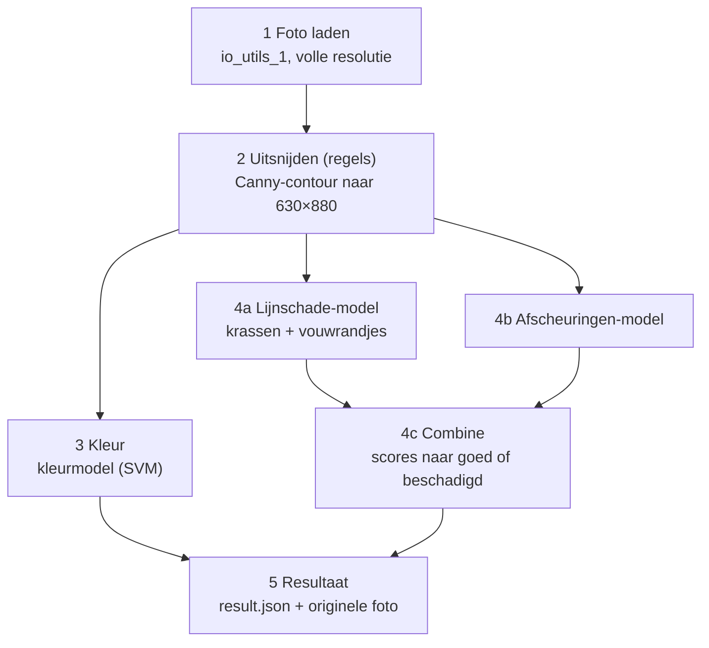

# Pipeline TCG-grading — hoe het werkt

Stand van 9 november 2026.

## Overzicht

De pipeline krijgt een map met kaartfoto's en geeft per kaart twee oordelen: de kleur van de kaart (wit, groen, rood, blauw, zwart) en Goed of Beschadigd. Sinds 7 november alleen MTG-voorkanten: game (MTG/Pokémon) en kant (voor/achter) vallen buiten de scope. Sinds 2 november is het een **multistage**-pipeline: elk onderdeel heeft een eigen model, dat los te bouwen, trainen en testen is. Alleen het uitsnijden werkt met regels die wij zelf kiezen, want dat haalt 40/40 zonder labels. Stap 1 t/m 3 en 5 werken; stap 4 is deels gebouwd (lijnschade eerste versie, de rest nog `NotImplementedError`).



Alle modellen krijgen dezelfde uitgesneden kleurenkaart. Elk schademodel doet zijn **eigen voorbewerking** (bijv. high-pass voor krassen) en levert een score van 0–1. `combine` maakt van die scores Goed of Beschadigd.

| Stap | Wat | Bestand | Status |
| --- | --- | --- | --- |
| 1 | Foto laden | `pipeline/io_utils_1.py` | Klaar |
| 2 | Kaart vinden, uitsnijden en rechttrekken (regels) | `pipeline/crop_2.py` | Klaar |
| 3 | Kleur: wit, groen, rood, blauw, zwart | `pipeline/identify_color_3.py` | Klaar (Thomas) |
| 4a | Lijnschade: krassen + vouwrandjes | `pipeline/damage_4/lines.py` | SVM op 19 standaardfeatures (final_dataset, scheur niet meegeteld: train 89%, val 92%, test 84%; gave kaarten afgekeurd 3/90) |
| 4b | Afscheuringen | `pipeline/damage_4/tear.py` | Te bouwen |
| 4c | Scores samenvoegen | `pipeline/damage_4/combine.py` | Klaar: beschadigd zodra één gebouwd model ≥ eigen drempel (`config.DAMAGE_THRESHOLDS`) |
| 5 | Resultaat + originele foto opslaan, overzicht van alle kaarten | `pipeline/report_5.py` | Klaar (`result.json` per kaart + `output/results/overzicht.csv`) |

Alle parameters staan op één plek: `pipeline/config.py`, elk met een naam en een reden. Trainingscode staat los in `training/` (per model: `python -m training.train <model>`); getrainde modellen komen in `models/`.

## Hoe draaien

Je start de pipeline met één commando op een map met foto's:

```
python main.py data/final_dataset/complete_dataset --debug
```

- **Invoer:** een map met `.jpg`, `.jpeg` of `.png`. De foto's worden op naam gesorteerd en één voor één verwerkt.
- **Eindresultaat:** per kaart een map `output/results/<fotonaam>/` met `result.json` (kleur, schade, score per schademodel, fout, nog niet gebouwd) en een kopie van de originele foto.
- **Overzicht en evaluatie:** na de run staat `output/results/overzicht.csv` (alle kaarten, `;`-gescheiden) klaar. Heten de foto's `<kleur>_<schade>_<nr>` (zoals onze dataset), dan vergelijkt `training/score_run.py` de uitkomst per split (train/validate/test) met de labels in de bestandsnaam en schrijft `output/results/evaluatie.txt`: kleur-accuracy, schade-accuracy/precision/recall, gave kaarten afgekeurd, gevonden per soort schade en een lijst foute kaarten.
- **Tussenresultaten (`--debug`):** per kaart een map `output/debug/<fotonaam>/` met een PNG per (sub)stap. Zonder `--debug` wordt er niets opgeslagen, dus geen schijfruimte gebruikt.
- **Nog niet gebouwde modellen** worden overgeslagen (waarde `null` in `result.json`); de andere modellen draaien door. Aan het eind meldt het programma per model de eerste functie die nog gebouwd moet worden, bijv. `damage_4.tear.preprocess`. Zo kan iedereen los aan een eigen model werken.

| Debugplaatje | Wat je ziet |
| --- | --- |
| `2a_blur.png` | Grijze, vervaagde kopie op ¼ grootte |
| `2b_canny.png` | De gevonden randen |
| `2c_closed.png` | Randen met de gaatjes dichtgemaakt |
| `2d_mask.png` | Het masker: kaart wit, achtergrond zwart |
| `2e_corners.png` | Masker met rechthoek en hoeknummers 0–3 |
| `2_crop.png` | De rechtgetrokken kaart, 630×880 |
| `4a_gray.png` | Lijnschade: grijze kaart |
| `4a_highpass.png` | Lijnschade: hoeveel lichter elke pixel is dan zijn omgeving (×4 versterkt om te kunnen zien) |
| `4b_…` | Tussenplaatjes van het afscheuringenmodel |

Installeren: Python 3.12, een `venv`, en `pip install -r requirements.txt` (OpenCV en NumPy, vastgepinde versies).

## Stap 1 — Foto laden

Stap 1 zoekt de foto's in de opgegeven map en laadt ze op volle resolutie (4032×3024) als BGR-array. Bestand: `pipeline/io_utils_1.py`.

- **`list_images(folder)`** geeft de foto's gesorteerd op naam terug. Extensies tellen ongeacht hoofdletters (`.JPEG` telt mee). Een map die niet bestaat of leeg is geeft een duidelijke foutmelding.
- **`load_image(path)`** leest de foto met `cv2.imread`. Waarom een eigen check: `imread` geeft bij een kapot bestand geen fout maar `None`, en dan zou de pipeline pas veel later vastlopen met een onduidelijke fout.
- **`save_debug_image(image, card, step)`** slaat een tussenresultaat op als PNG in `output/debug/<kaart>/`. Waarom PNG: JPEG-compressie geeft blokjes die later op krasjes kunnen lijken.
- **Valkuil:** OpenCV laadt kleuren als BGR, niet RGB.

## Stap 2 — Kaart uitsnijden en rechttrekken

Stap 2 vindt de kaart op de witte achtergrond en levert een rechte, staande kaart van 630×880 px (63×88 mm bij 10 px/mm). Alle 180 foto's van `final_dataset` slagen, ook de gescheurde kaarten; het kost 33 ms per foto. Bestand: `pipeline/crop_2.py`.

**Twee ideeën achter deze stap:**

- **Zoeken klein, rechttrekken groot.** De kaart wordt gezocht op een kopie van ¼ grootte (1008×756): snel, en precies genoeg voor de omtrek. Het rechttrekken gebeurt vanuit de volle foto, zodat er zo veel mogelijk detail overblijft voor de schadestap.
- **Canny-contour in plaats van kleur.** Gekozen na een test van 3 methodes op 40 foto's: Canny haalde 40/40, donkere rand + Otsu 35/40, de oude helderheidsmethode 0/40. Canny leunt niet op de zwarte rand van MTG-kaarten, dus werkt later ook bij de gele rand van Pokémon.

**De substappen:**

1. **Verkleinen (`crop_card`).** `cv2.resize` naar ¼ met `INTER_AREA`, dat pixels middelt zodat er geen trapjes of ruis ontstaan.
2. **Grijs + vervagen (`find_card_mask`, plaatje 3a).** `GaussianBlur` met σ = 2 strijkt papierstructuur en ruis glad, zodat Canny alleen nog op de omtrek reageert.
3. **Randen zoeken (3b).** `Canny` met drempels 40/120: boven 120 is het zeker een rand, tussen 40 en 120 alleen als hij aan een sterke rand vastzit.
4. **Gaten dichten (3c).** Morfologisch sluiten (eerst dilateren, dan eroderen) met een ellips van 15 px maakt de omtrek dicht waar Canny onderbrekingen liet.
5. **Masker maken (3d).** `findContours` met `RETR_EXTERNAL` pakt alleen buitenomtrekken, dus geen lijnen in de afbeelding. Omtrekken die de fotorand raken vallen af (schaduw, tafelrand). De grootste wordt gevuld getekend: kaart wit, achtergrond zwart.
6. **Hoeken vinden (`find_card_corners`, 3e).** `minAreaRect` legt de kleinste gedraaide rechthoek om het masker. Gekozen boven `approxPolyDP`, omdat die bij een afgescheurde hoek 5 punten geeft en door de ronde kaarthoeken ~1 mm van de rand afsnijdt.
7. **Vormcontrole.** Vulling = oppervlak masker / oppervlak rechthoek. Onze foto's halen 0,955–0,991; onder 0,90 is het geen kaart en volgt `CardNotFoundError`.
8. **Hoeken ordenen (`_order_corners`).** Klokwijs, beginnend linksboven aan de bovenste korte zijde, zodat een kaart die opzij ligt er toch staand uitkomt. Rechtop of ondersteboven maakt niet uit.
9. **Terugschalen.** De hoeken ×4, naar coördinaten in de volle foto.
10. **Rechttrekken (`warp_card`, 2_crop).** Eerst `warpPerspective` naar de ware grootte van de kaart in de foto (~1570×2190), dan `resize` met `INTER_AREA` naar 630×880. In één keer verkleinen met `INTER_LINEAR` sloeg pixels over: korrelig papier en rafelige krassen.

| Parameter (`config.py`) | Waarde | Waarom |
| --- | --- | --- |
| `DETECT_SCALE` | 0.25 | Zoeken op 1008×756; blur en kernel zijn op deze schaal afgesteld |
| `CROP_BLUR_SIGMA` | 2 | Papierstructuur en ruis gladstrijken |
| `CROP_CANNY_LOW` / `HIGH` | 40 / 120 | Donkere kaartrand tegen witte achtergrond |
| `CROP_CLOSE_KERNEL_PX` | 15 | Gaten in de omtrek tot ~15 px dichten |
| `CROP_MIN_FILL` | 0.90 | Onze foto's 0,955–0,991; daaronder geen kaartvorm |
| `PX_PER_MM` | 10 | Uitvoer 630×880; voorlopig, testen bij stap 5 |

## Stap 3 — Kleur van de kaart

Stap 3 bepaalt de kleur van een MTG-kaart: `white`, `green`, `red`, `blue` of `black`. Het model werkt op de kleurenkaart van stap 2. Bestand: `pipeline/identify_color_3.py` (gebouwd door Thomas). Game (MTG/Pokémon) en kant (voor/achter) zijn uit de scope (beslissing 2026-11-07).

- **Features:** uitsnede onderin de kaart (tekstvak met het grote mana-symbool, 62–92% van de hoogte, 12–88% van de breedte). Daarvan een HSV-histogram (18 tinten × 8 verzadigingen, genormaliseerd) plus gemiddelde en standaardafwijking per kanaal in HSV en LAB.
- **Classifier:** `StandardScaler` + `SVC` (RBF-kernel, `C=10`, `class_weight="balanced"`), opgeslagen als `models/color_model.joblib`.
- **Functies:** `features(card)`, `train`, `save_model` / `load_model` en `predict`.

## Stap 4 — Schade: één model per soort (te bouwen)

Schade wordt gezocht door twee modellen in `pipeline/damage_4/` (beslissingen 2026-11-02 en 2026-11-05: krassen en vouwrandjes zijn samengevoegd, omdat ze er met schuin licht allebei uitzien als lichte lijnen). Elk model doet zijn eigen voorbewerking, omdat elke soort schade anders zichtbaar is:

| Model | Bestand | Wat | Idee |
| --- | --- | --- | --- |
| 4a lijnschade | `lines.py` | krassen (fijne lijntjes) en vouwrandjes (teruggevouwen vouw met een randje) | lichte lijnen; SVM op histogram + Hough-lijnen |
| 4b afscheuringen | `tear.py` | er ontbreekt een stuk kaart | zichtbaar aan de omtrek (nodig: het masker uit stap 2) |
| 4c combine | `combine.py` | scores naar Goed / Beschadigd | beschadigd zodra één gebouwd model boven zijn drempel komt; niet-gebouwde modellen overgeslagen (`damage_checked`) |

**Elk schademodel heeft dezelfde 6 functies**, zodat `main.py` en `training/` ze allemaal op dezelfde manier aanroepen: `preprocess(card, show)`, `features(image)`, `train(features, labels)`, `save_model(model)`, `load_model()` en `predict(model, features)` (score 0–1). De lijst `MODELS` in `damage_4/__init__.py` zegt welke modellen er zijn.

- **Een model toevoegen** (later bijv. snedes of dichte vouwen): kopieer `lines.py`, bouw de 6 functies, zet één regel in `MODELS`.
- **Bouwvolgorde:** `main.py` roept eerst `preprocess` en `features` aan, pas daarna `load_model`. Je kunt de voorbewerking dus met `--debug` bekijken voordat er een getraind model is.
- **Niet gebouwd = overslaan:** `main.py` vangt `NotImplementedError` per model af, zodat één onaf model de rest niet blokkeert. `combine` draait over de modellen die wél een score gaven (beslissing 2026-11-07); `damage_checked` in `result.json` laat zien welke dat waren, zodat "goed" nu zichtbaar "goed voor lijnschade" betekent. Geeft geen enkel model een score, dan is er geen eindoordeel.
- **Labels** komen uit de bestandsnaam (`training/dataset.py`): `kras` en `vouw` = 1 voor lijnschade, `scheur` = 1 voor afscheuringen en 0 voor lijnschade, `geen` = 0 voor elk model. `mix` doet voorlopig niet mee: niet bekend welke schade erop zit.

## Stap 5 — Resultaat

Per kaart `output/results/<fotonaam>/result.json` met `photo`, `color`, `damage`, `damage_scores` (per model), `damage_checked` (welke modellen meededen), `error` en `not_built`, plus een kopie van de originele foto. Daarnaast `output/results/overzicht.csv` met één rij per kaart. Een foto waarop geen kaart gevonden wordt krijgt een `error` en de run gaat door. Bestand: `pipeline/report_5.py`.

## Training

`python -m training.train <model>` en `python -m training.evaluate <model>`, met `<model>` = `lines` of `tear`. Het kleurmodel heeft een eigen script: `python -m training.train_color` (trainen + validate) en `python -m training.train_color --test`. Het algemene deel (foto's laden, uitsnijden, label per model, splitsen) staat in `training/`; het modelspecifieke deel (`train`, `save_model`) in het modelbestand zelf.

- **Data:** `--data <map>` met de submappen `train_dataset/`, `validate_dataset/` en `test_dataset/`. Standaard is `config.DATASET_DIR` (`data/final_dataset`). De split komt uit die mappen; foto's in submappen (één per kleur in `final_dataset`) tellen ook mee.
- **`train`** traint op `train_dataset`, slaat het model op in `models/` en print het rapport voor train en validate. **`evaluate`** print het rapport voor `test_dataset`.
- **Rapport:** score per foto, confusion matrix, accuracy, precision en recall. Een score ≥ 0,5 telt daarin als schade; dat is alleen voor het rapport, de echte drempel komt in `combine`.
- **Lijnschade-model (4a):** 19 getallen per kaart, allemaal standaardfuncties op het high-pass-beeld: (1) 11 histogramwaarden (hoeveel van de kaart hoeveel lichter is dan zijn omgeving) en (2) 8 Hough-getallen (`HoughLinesP` op pixels boven `LINES_BRIGHT` = 35: per lengteklasse 6–15, 15–30, 30–60 en >60 mm het aantal schuine lijnen en de log van hun totale lengte). Classifier = `StandardScaler` + `SVC` (RBF, standaardinstellingen), net als het kleurmodel. Het model in `models/lines.joblib` is een scikit-learn-pipeline.
- Nog open: welke fout het ergst is.

## Open punten en beperkingen

- [x] `CardNotFoundError` per foto afvangen in `main.py` (gedaan 2026-11-07).
- [ ] Afscheuringenmodel (`tear.py`) bouwen; het heeft het masker van stap 2 nodig, `crop_card` geeft nu alleen de kaart terug. Zonder dit is het eindoordeel recall ~51% (alle `scheur`-kaarten worden gemist).
- [ ] Drempel van `tear` in `DAMAGE_THRESHOLDS` (nu een placeholder 0,5); die van `lines` is 0,5.
- [ ] Labels voor de `mix`-foto's (welke schade zit erop).
- [ ] Beeldverhoudingscontrole (lang/kort 1,30–1,50) toevoegen naast de vulcontrole?
- [ ] `PX_PER_MM = 10` testen bij het krassenmodel (de foto heeft ~25 px/mm).
- [ ] Scheefstand van de camera (10 van de 40 handgemaakte foto's: de ene korte zijde 2–3 mm breder) wordt niet gecorrigeerd; lensvervorming (undistort) doen we niet (beslissing 2026-11-09).
- [ ] Modellen één keer laden voor alle foto's zodra ze bestaan.

**Bekende beperkingen:**

- Alleen getest op onze eigen 180 foto's (5 kleuren, MTG-voorkant) op één witte achtergrond met één belichting; het uitsnijden slaagde op alle 180. Vaste Canny-drempels kunnen breken bij ander licht.
- Het lijnmodel keurt ~3% van de gave kaarten af (3/90) en mist ~22% van de kras/vouw-kaarten; het getekende kaartontwerp (kaders, tekst) geeft ook lichte lijnen.
- Bij een scheve foto komt aan de smalle kant ~1,5 mm achtergrond mee in de uitsnede.
- Een zwaar gescheurde kaart (vulling onder 0,90) wordt afgekeurd in plaats van als Beschadigd geclassificeerd.
- Er is geen met de hand gemarkeerde "echte" uitsnede; de controle is vorm + visueel.
