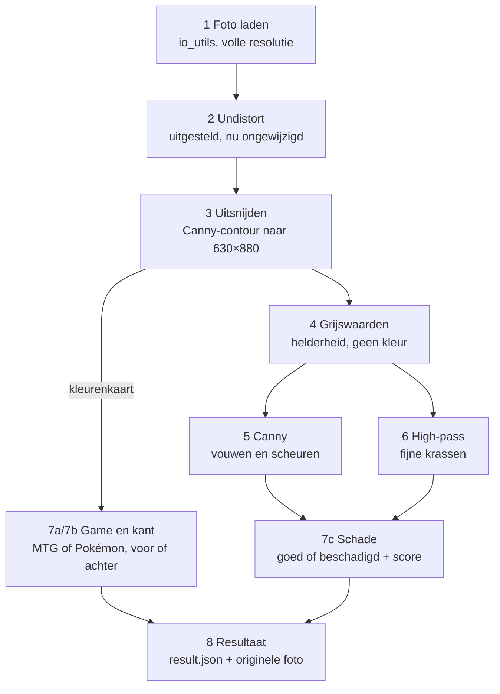

# Pipeline TCG-grading — hoe het werkt

Stand van 26 oktober 2026.

## Overzicht

De pipeline krijgt een map met kaartfoto's en geeft per kaart drie oordelen: Pokémon of MTG, voor- of achterkant, en Goed of Beschadigd. Stap 1 t/m 3 werken: alle 40 foto's van `data/schade_class_v2` worden goed uitgesneden. De rest bestaat als skelet (functienamen en docstrings, nog `NotImplementedError`).



Game en kant worden bepaald op de kleurenkaart; de schade op de drie bewerkte plaatjes van stap 4–6. Beide paden komen samen in één resultaat per kaart.

| Stap | Wat | Bestand | Status |
| --- | --- | --- | --- |
| 1 | Foto laden | `pipeline/io_utils.py` | Klaar |
| 2 | Lensvervorming corrigeren (undistort) | `pipeline/undistort.py` | Uitgesteld |
| 3 | Kaart vinden, uitsnijden en rechttrekken | `pipeline/crop.py` | Klaar |
| 4 | Grijswaarden | `pipeline/preprocess.py` | Te bouwen |
| 5 | Randen zoeken (Canny) | `pipeline/preprocess.py` | Te bouwen |
| 6 | Krassen versterken (high-pass) | `pipeline/preprocess.py` | Te bouwen |
| 7 | Classificatie: game, kant, schade | `pipeline/features.py`, `pipeline/classify.py` | Te bouwen |
| 8 | Resultaat + originele foto opslaan | `pipeline/report.py` | Te bouwen |

Alle parameters staan op één plek: `pipeline/config.py`, elk met een naam en een reden. Trainingscode staat los in `training/`; getrainde modellen komen in `models/`.

## Hoe draaien

Je start de pipeline met één commando op een map met foto's:

```
python main.py data/schade_class_v2/complete_dataset --debug
```

- **Invoer:** een map met `.jpg`, `.jpeg` of `.png`. De foto's worden op naam gesorteerd en één voor één verwerkt.
- **Eindresultaat:** per kaart een map `output/results/<fotonaam>/` met `result.json` (game, kant, schade, schadescore, fout) en een kopie van de originele foto.
- **Tussenresultaten (`--debug`):** per kaart een map `output/debug/<fotonaam>/` met een PNG per (sub)stap. Zonder `--debug` wordt er niets opgeslagen, dus geen schijfruimte gebruikt.
- **Nu:** het programma stopt na stap 3 met de melding *"Pipeline stopt: 'preprocess.to_gray' is nog niet gebouwd."* Dat is verwacht; het skelet meldt steeds de eerste functie die nog gebouwd moet worden.

| Debugplaatje | Wat je ziet |
| --- | --- |
| `2_undistort.png` | De foto na stap 2 (nu nog gelijk aan het origineel) |
| `3a_blur.png` | Grijze, vervaagde kopie op ¼ grootte |
| `3b_canny.png` | De gevonden randen |
| `3c_closed.png` | Randen met de gaatjes dichtgemaakt |
| `3d_mask.png` | Het masker: kaart wit, achtergrond zwart |
| `3e_corners.png` | Masker met rechthoek en hoeknummers 0–3 |
| `3_crop.png` | De rechtgetrokken kaart, 630×880 |

Installeren: Python 3.12, een `venv`, en `pip install -r requirements.txt` (OpenCV en NumPy, vastgepinde versies).

## Stap 1 — Foto laden

Stap 1 zoekt de foto's in de opgegeven map en laadt ze op volle resolutie (4032×3024) als BGR-array. Bestand: `pipeline/io_utils.py`.

- **`list_images(folder)`** geeft de foto's gesorteerd op naam terug. Extensies tellen ongeacht hoofdletters (`.JPEG` telt mee). Een map die niet bestaat of leeg is geeft een duidelijke foutmelding.
- **`load_image(path)`** leest de foto met `cv2.imread`. Waarom een eigen check: `imread` geeft bij een kapot bestand geen fout maar `None`, en dan zou de pipeline pas veel later vastlopen met een onduidelijke fout.
- **`save_debug_image(image, card, step)`** slaat een tussenresultaat op als PNG in `output/debug/<kaart>/`. Waarom PNG: JPEG-compressie geeft blokjes die later op krasjes kunnen lijken.
- **Valkuil:** OpenCV laadt kleuren als BGR, niet RGB.

## Stap 2 — Lensvervorming corrigeren (uitgesteld)

Stap 2 geeft de foto voorlopig onveranderd terug. Bestand: `pipeline/undistort.py`.

- **Waarom uitgesteld:** kalibratie geldt per camera, en welke camera we gebruiken staat nog niet vast (waarschijnlijk een iPhone, die lensvervorming al grotendeels in software corrigeert).
- **Later, met een vaste camera:** kalibreren met een schaakbordpatroon (`cv2.calibrateCamera` + `cv2.undistort`), en daarna met een foto van een recht raster controleren of rechte lijnen recht blijven.
- **Ook voor deze stap: scheefstand.** Een camera die vast boven de band hangt, hangt bij elke kaart even scheef. Op onze handgemaakte foto's is bij 10 van de 40 de ene korte zijde 2–3 mm breder dan de andere. Die scheefstand werken we hier één keer voor de hele foto weg, zodat stap 3 hem niet hoeft op te lossen.

## Stap 3 — Kaart uitsnijden en rechttrekken

Stap 3 vindt de kaart op de witte achtergrond en levert een rechte, staande kaart van 630×880 px (63×88 mm bij 10 px/mm). Alle 40 foto's van `schade_class_v2` slagen, ook de gescheurde kaarten; het kost 33 ms per foto. Bestand: `pipeline/crop.py`.

**Twee ideeën achter deze stap:**

- **Zoeken klein, rechttrekken groot.** De kaart wordt gezocht op een kopie van ¼ grootte (1008×756): snel, en precies genoeg voor de omtrek. Het rechttrekken gebeurt vanuit de volle foto, zodat er zo veel mogelijk detail overblijft voor de schadestap.
- **Canny-contour in plaats van kleur.** Gekozen na een test van 3 methodes op 40 foto's: Canny haalde 40/40, donkere rand + Otsu 35/40, de oude helderheidsmethode 0/40. Canny leunt niet op de zwarte rand van MTG-kaarten, dus werkt later ook bij de gele rand van Pokémon.

**De substappen:**

1. **Verkleinen (`crop_card`).** `cv2.resize` naar ¼ met `INTER_AREA`, dat pixels middelt zodat er geen trapjes of ruis ontstaan.
2. **Grijs + vervagen (`find_card_mask`, plaatje 3a).** `GaussianBlur` met σ = 2 strijkt papierstructuur en ruis glad, zodat Canny alleen nog op de omtrek reageert.
3. **Randen zoeken (3b).** `Canny` met drempels 40/120: boven 120 is het zeker een rand, tussen 40 en 120 alleen als hij aan een sterke rand vastzit.
4. **Gaten dichten (3c).** Morfologisch sluiten (eerst dilateren, dan eroderen) met een ellips van 15 px maakt de omtrek dicht waar Canny onderbrekingen liet.
5. **Masker maken (3d).** `findContours` met `RETR_EXTERNAL` pakt alleen buitenomtrekken, dus geen lijnen in de afbeelding. Omtrekken die de fotorand raken vallen af (schaduw, tafelrand). De grootste wordt gevuld getekend: kaart wit, achtergrond zwart.
6. **Hoeken vinden (`find_card_corners`, 3e).** `minAreaRect` legt de kleinste gedraaide rechthoek om het masker. Gekozen boven `approxPolyDP`, omdat die bij een afgescheurde hoek 5 punten geeft en door de ronde kaarthoeken ~1 mm van de rand afsnijdt.
7. **Vormcontrole.** Vulling = oppervlak masker / oppervlak rechthoek. Onze foto's halen 0,955–0,991; onder 0,90 is het geen kaart en volgt `CardNotFoundError`.
8. **Hoeken ordenen (`_order_corners`).** Klokwijs, beginnend linksboven aan de bovenste korte zijde, zodat een kaart die opzij ligt er toch staand uitkomt. Rechtop of ondersteboven maakt niet uit.
9. **Terugschalen.** De hoeken ×4, naar coördinaten in de volle foto.
10. **Rechttrekken (`warp_card`, 3_crop).** Eerst `warpPerspective` naar de ware grootte van de kaart in de foto (~1570×2190), dan `resize` met `INTER_AREA` naar 630×880. In één keer verkleinen met `INTER_LINEAR` sloeg pixels over: korrelig papier en rafelige krassen.

| Parameter (`config.py`) | Waarde | Waarom |
| --- | --- | --- |
| `DETECT_SCALE` | 0.25 | Zoeken op 1008×756; blur en kernel zijn op deze schaal afgesteld |
| `CROP_BLUR_SIGMA` | 2 | Papierstructuur en ruis gladstrijken |
| `CROP_CANNY_LOW` / `HIGH` | 40 / 120 | Donkere kaartrand tegen witte achtergrond |
| `CROP_CLOSE_KERNEL_PX` | 15 | Gaten in de omtrek tot ~15 px dichten |
| `CROP_MIN_FILL` | 0.90 | Onze foto's 0,955–0,991; daaronder geen kaartvorm |
| `PX_PER_MM` | 10 | Uitvoer 630×880; voorlopig, testen bij stap 6 |

## Stap 4–6 — Voorbewerking voor de schadestap (te bouwen)

Stap 4–6 maken van de uitgesneden kaart drie plaatjes waarin schade beter meetbaar is. Bestand: `pipeline/preprocess.py`. De parameters zijn nog open.

- **Stap 4, `to_gray`:** kleur naar grijswaarden. Krassen, vouwen en scheuren zijn verschillen in helderheid, niet in kleur.
- **Stap 5, `detect_edges`:** Canny op de kaart zelf. Een vouw of scheur geeft een lange, scherpe rand waar een gave kaart die niet heeft.
- **Stap 6, `high_pass`:** alleen het fijne detail overhouden (wat snel verandert), zodat dunne krassen opvallen en de grote vlakken van de afbeelding wegvallen.
- **Waarom het schuine licht ertoe doet:** krassen en vouwen vangen het licht onder een hoek en worden daardoor lichter dan hun omgeving. Dat helderheidsverschil is wat stap 5 en 6 oppikken.
- **Hier testen we ook** of 10 px/mm genoeg is, en of de korrel van het papier door het high-pass filter als kras wordt gezien.

## Stap 7–8 — Classificatie en resultaat (te bouwen)

Stap 7 zet de plaatjes om in getallen (features) en laat drie classifiers na elkaar beslissen; stap 8 slaat het oordeel op. Welke features en welk type classifier zijn nog open.

- **Features (`pipeline/features.py`):** `game_features` en `side_features` werken op de kleurenkaart; `damage_features` op de drie plaatjes van stap 4–6.
- **Classifiers (`pipeline/classify.py`):** eerst game (`mtg` / `pokemon`), dan kant (`front` / `back`), dan schade (`goed` / `beschadigd`) met een schadescore. De grens tussen goed en beschadigd wordt een instelbare drempel op die score.
- **Modellen laden:** pas vlak voor het classificeren, niet aan het begin. Zo werken uitsnijden en voorbewerken ook zonder model. Zodra er modellen zijn, laden we ze één keer voor alle foto's.
- **Training (`training/`):** labels komen uit de bestandsnaam (`wit_kras_03.jpeg` → kleur `wit`, schade `kras`, klasse `beschadigd`), dan een train/val/test-verdeling. Getrainde modellen gaan naar `models/`.
- **Resultaat (`pipeline/report.py`):** per kaart `output/results/<fotonaam>/result.json` met `photo`, `game`, `side`, `damage`, `damage_score` en `error`, plus een kopie van de originele foto.

## Open punten en beperkingen

- [ ] `CardNotFoundError` per foto afvangen in `main.py`; nu stopt de hele map bij één afgekeurde kaart.
- [ ] Beeldverhoudingscontrole (lang/kort 1,30–1,50) toevoegen naast de vulcontrole?
- [ ] `PX_PER_MM = 10` testen bij stap 6 (de foto heeft ~25 px/mm).
- [ ] Scheefstand van de camera wegwerken in stap 2 zodra de camera vastzit.
- [ ] Modellen één keer laden voor alle foto's zodra ze bestaan.

**Bekende beperkingen:**

- Alleen getest op witte kaarten (Plains) op één witte achtergrond met één belichting. Vaste Canny-drempels kunnen breken bij ander licht.
- Bij een scheve foto komt aan de smalle kant ~1,5 mm achtergrond mee in de uitsnede.
- Een zwaar gescheurde kaart (vulling onder 0,90) wordt afgekeurd in plaats van als Beschadigd geclassificeerd.
- Er is geen met de hand gemarkeerde "echte" uitsnede; de controle is vorm + visueel.
